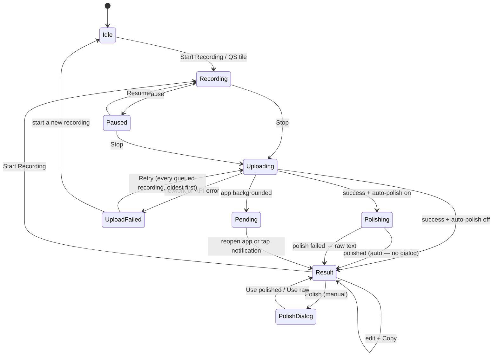

# UI flow

How a recording becomes text on the clipboard, and which component owns each transition. This is the map to read before changing anything in `MainActivity` or `RecordingService` — the flow has more branches than the feature list suggests, and several of them exist to prevent data loss.

## State diagram

## Who owns what

| Transition | Owner | Notes |
|---|---|---|
| Start / stop / pause / resume | `RecordingService` | Driven by `ACTION_*` intents from the activity, the notification, or the tile |
| Resolving the microphone route | `RecordingService.resolveRoutedDevice` | `MediaRecorder.getRoutedDevice()` after `start()`, retried once after 150 ms; sent as `STATE_ROUTE` so `STATE_RECORDING` stays instant |
| Recording → Uploading | `RecordingService.stopRecording` | Computes duration from active (non-paused) time only |
| Upload + retry | `RecordingService.sendAudioToGroq` | One automatic retry on `IOException` before giving up |
| Response parsing + quality metrics | `TranscriptionResponse.parse` | `verbose_json`; malformed statistics degrade to null rather than losing the transcript |
| **Saving history** | `RecordingService` | Written the moment the transcription arrives — see below |
| Polish | `MainActivity.startPolish` | Uses the selected preset; auto-polish skips the dialog |
| Result screen, editing, clipboard | `MainActivity` | Updates the entry the service created; never creates a second one |

## The three branches that exist to prevent data loss

**1. History is saved by the service, not the UI.** `MainActivity` unregisters its broadcast receiver in `onStop()`. If the user locks the screen or switches apps while the upload is in flight, `STATE_SUCCESS` fires into a dead receiver. The service therefore writes the history entry itself, stores its id under `pending_result_id`, and posts a **Transcription ready** notification. `MainActivity.onStart()` claims the pending result and opens the result screen with the text copied.

A service-side clipboard write is *not* a substitute — Android 10+ blocks clipboard access for apps that are not in focus.

**2. Failed uploads keep their audio, and there can be more than one.** Recordings use unique filenames, so a failure is not overwritten by the next take. Each failure joins `UploadQueue`, a list in preferences, and stays there until it is transcribed. **Retry** sends the whole list oldest first, one upload at a time. Each note is saved to history as it lands and only the last is broadcast as `STATE_SUCCESS`. Any failure ends the run and moves that recording to the back, so one that can never succeed does not block the rest. Recordings are written to `filesDir/audio`, which Android does not clear under storage pressure, and are excluded from backup. Before v2.8.4 there was a single slot, `failed_audio_path`, and a second failure orphaned the first.

**3. The mic indicator never guesses.** It reports what `getRoutedDevice()` returned, or "unknown" — never an inference from which devices happen to be connected. The old indicator enumerated *available* inputs and so displayed "Bluetooth Mic" whenever a headset was paired, while the built-in mic recorded. That single false label cost two days of unusable dictation before anyone suspected the audio path. See [audio-investigation-2026-07.md](audio-investigation-2026-07.md).

**4. Choosing raw never discards polished.** Both versions are stored on the entry regardless of which one is displayed, so the **Show raw / Show polished** toggle and history's "Original raw" section always have something to show.

## Error branches

| Condition | Behaviour |
|---|---|
| No network at upload time | `STATE_ERROR`, audio kept, Retry offered |
| Upload > 24 MB | `STATE_ERROR` naming the size; audio kept but needs splitting |
| API error (401, 429, 5xx) | `STATE_ERROR` with the code; audio kept for a manual retry |
| Polish fails (auto) | Result screen opens with **raw** text, copied, plus a toast |
| Polish fails (manual) | Status line clears, text untouched, error toast |
| Polish length guard trips | Treated as a failure → raw kept (Clean prose only) |
| Permission denied at start | Nothing is cleared — the previous result stays on screen |

## Key state

`MainActivity` fields that survive rotation via `onSaveInstanceState`:

- `showingResult` — result screen vs recording screen
- `resultShowsPolished` — which variant the field holds (drives the label and toggle)
- `lastHistoryEntryId` — the entry to update on edit; **set from the service's broadcast**, not created locally
- `lastRawTranscription`, `lastDurationSeconds`

### Live state: what the service is doing right now

`MainActivity` unregisters its receiver in `onStop()`, so it misses every broadcast sent while the screen is off or another app is in front: a stop from the notification, a start or stop from the tile, a pause, an upload finishing or failing. Broadcasts are not replayed. The service therefore keeps its current state in memory, in `RecordingService`'s companion object, and `MainActivity.syncWithService()` reads it at the top of every `onStart()`, before `consumePendingResult()`.

| Field | Meaning |
|---|---|
| `liveState` | `idle`, `recording`, `paused` or `uploading`. Worked out from what the service is doing (recording wins over uploading) each time that changes, on the main thread |
| `liveActiveMillis()` | Recorded time with pauses excluded, for the timer |
| `liveRouteLabel`, `liveRouteSampleRate` | The microphone line |
| `liveLastError` | The last error broadcast, until a screen has shown it |
| `uploadInFlight` | True while an upload or a run of them is going. Separate from `liveState` because a new recording can start during an upload, and then the state reads `recording` |

Everything that ends an upload run (the broadcast, the live state, stopping the service) runs on the main thread, where recordings start and stop. When a run ends while a newer recording has the screen, nothing is broadcast: the note is in history, a notification says so, and it is counted into the next result's "earlier ones are in History" message. A failure in that position is held in `liveLastError` and shown with the next result or on the next return to the app.

There is one upload at a time. A recording that stops while another is uploading joins the queue and the running chain picks it up. The service stops only when it is neither recording nor uploading, and that check runs on the main thread. While `uploadInFlight` is true the activity hides Retry, does not offer the checkpoint as an unfinished recording, and leaves `pending_result_id` unclaimed.

It is memory, not a preference, on purpose. The activity, the tile and the service share one process, so the state resets when the process dies. The `is_recording` preference it replaced outlived a crash and left the tile reading "Recording".

Until v2.8.4 nothing did this. Stopping from the lock-screen notification left the activity believing it was still recording: the note reached history, but the screen showed Stop Recording with the timer running and never showed or copied the result.

Shared preferences crossing the process boundary (all in `StowPrefs`):

| Key | Written by | Read by |
|---|---|---|
| `pending_result_id` | service | activity (`onStart`) |
| _(files)_ `Documents/responses/<entryId>.json` | service | manual troubleshooting; capped at 20, oldest pruned |
| _(files)_ `files/audio/audio_<ts>.m4a` | service | Share audio / Re-transcribe; newest 5 kept for 7 days, plus every recording not yet transcribed. Versions before 2.8.4 wrote to `cache/`, and those files are still found there |
| `ui_visible` | activity | service (whether to notify) |
| `upload_queue` | service, activity | activity (Retry button), service (retry run). JSON list of recordings awaiting upload. See `UploadQueue` |
| `failed_audio_path`, `failed_audio_duration` | nobody since v2.8.4 | `UploadQueue.load`, once, to carry a pre-2.8.4 retry into the queue |
| `selected_polish_preset`, `polish_presets` | activity | activity |
